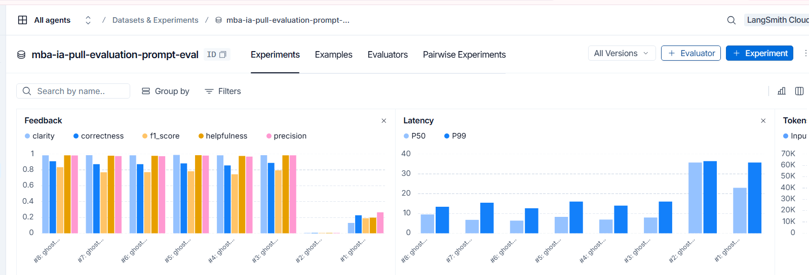
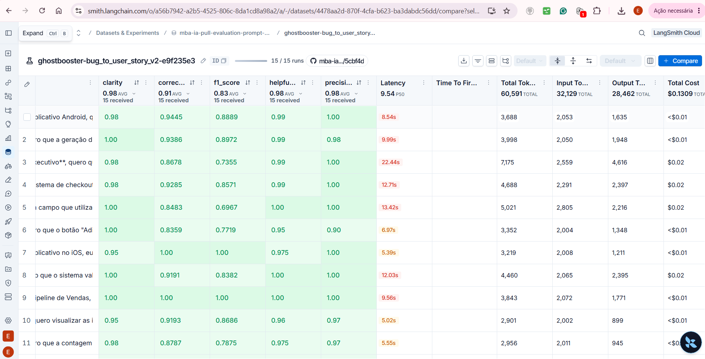

# Documentação do processo de evolução do prompt `bug_to_user_story`

## 1. Contexto inicial e referência no LangSmith

O prompt original `bug_to_user_story_v1.yml`, disponível no LangSmith,
para pull apresenta algumas diferenças em relação à versão
`bug_to_user_story_v1.yml` mantida no repositório Git utilizado como
fork, mas isso não é um problema, apenas uma curiosidade.

O experimento utilizado para acompanhar e comparar as execuções está
disponível no LangSmith:

[**Acessar experimento no
LangSmith**](https://smith.langchain.com/o/a56b7942-a2b5-4525-806c-8da1cd8a98a2/datasets/4478aa2d-870f-4cfa-b623-ba3dabdc56dd/compare?selectedSessions=d6bd1218-0c18-46cc-9073-45e3e6002b2a)

### Imagem iterações



#### Imagem iteração com sucesso


**Nota**: As duas primeiras iteraações estava sem créditos e por isso o pontuação tão baixa. Sendo assim considero como 1 a terceira iteração na tela do Langsmith

### 1.1 Experimentos com falha, apenas para acompanhamento

[**Iteração 1 no LangSmith**](https://smith.langchain.com/o/a56b7942-a2b5-4525-806c-8da1cd8a98a2/a/-/datasets/4478aa2d-870f-4cfa-b623-ba3dabdc56dd/compare?selectedSessions=e9bb0934-e902-4ae3-8da9-389a127ef95e)

[**Iteração 2 no LangSmith**](https://smith.langchain.com/o/a56b7942-a2b5-4525-806c-8da1cd8a98a2/a/-/datasets/4478aa2d-870f-4cfa-b623-ba3dabdc56dd/compare?selectedSessions=67b8294d-c08c-48b4-9472-e5e7561f0372)

[**Iteração 3 no LangSmith**](https://smith.langchain.com/o/a56b7942-a2b5-4525-806c-8da1cd8a98a2/a/-/datasets/4478aa2d-870f-4cfa-b623-ba3dabdc56dd/compare?selectedSessions=44a40ebd-9a4c-493a-b394-38865547023b)

[**Iteração 4 no LangSmith**](https://smith.langchain.com/o/a56b7942-a2b5-4525-806c-8da1cd8a98a2/a/-/datasets/4478aa2d-870f-4cfa-b623-ba3dabdc56dd/compare?selectedSessions=5f79c910-5036-4935-b34d-8fea3923f1ff)

[**Iteração 5 no LangSmith**](https://smith.langchain.com/o/a56b7942-a2b5-4525-806c-8da1cd8a98a2/a/-/datasets/4478aa2d-870f-4cfa-b623-ba3dabdc56dd/compare?selectedSessions=d23fdeef-6639-4296-8eb2-51578c8ac158)


## 2. Objetivo

Evoluir o prompt responsável por transformar relatos de bugs em User
Stories, buscando respostas que:

-   Representem com precisão o problema relatado.
-   Preservem os requisitos funcionais e técnicos relevantes.
-   Apresentem critérios de aceitação claros e verificáveis no formato
    BDD.
-   Evitem omissões de informações importantes.
-   Não introduzam suposições como se fossem requisitos confirmados.

A avaliação considera principalmente **Precision, Recall e F1**,
buscando equilíbrio entre a correção das informações geradas e a
cobertura dos elementos esperados.

## 3. Técnicas utilizadas

### 3.1. Chain-of-Thought (CoT)

Foi utilizada a técnica Chain-of-Thought para orientar o modelo a
realizar uma análise estruturada antes de produzir a User Story.

As instruções passaram a orientar etapas internas como:

1.  Compreender o relato e identificar o problema e o comportamento
    esperado.
2.  Extrair e classificar informações relevantes, incluindo regras de
    negócio e requisitos técnicos.
3.  Identificar informações ausentes, ambíguas ou inconsistentes.
4.  Elaborar a User Story e os critérios de aceitação em BDD.
5.  Revisar a resposta para verificar a cobertura dos requisitos e a
    preservação dos detalhes.

Após a inclusão dessas instruções, os resultados começaram a apresentar
melhora depois de aproximadamente duas iterações. A técnica ajudou a
orientar a análise e a revisão da resposta antes da geração final.

O prompt determina que essas etapas sejam executadas internamente, sem
apresentar o raciocínio interno ao usuário. A saída deve conter somente
a User Story estruturada.

### 3.2. Few-Shot Prompting

Também foi utilizada a técnica Few-Shot, por meio da inclusão de
exemplos de entrada (`bug_report`) e saída esperada (`reference`)
diretamente no prompt.

Os exemplos têm a finalidade de demonstrar ao modelo:

-   Como estruturar a User Story.
-   Como identificar a persona e o contexto.
-   Como elaborar critérios de aceitação em BDD.
-   Como tratar relatos insuficientes ou inconsistentes.
-   Como representar diferentes comportamentos em cenários separados.

Durante as primeiras avaliações, foi identificado que os exemplos
utilizados eram muito simples e nem sempre representavam adequadamente a
complexidade dos relatos reais.

Além disso, alguns exemplos apresentavam cenários mistos, com mais de
uma verificação dentro de uma mesma estrutura **Dado... Quando...
Então...**. Essa organização pode ter prejudicado a compreensão do
padrão desejado e contribuído para a geração de critérios menos
específicos.

Nas iterações 4, 5 e 6, foram realizados ajustes na abordagem e na
estrutura dos exemplos, buscando cenários mais claros e verificações
mais bem delimitadas. Após esses ajustes, os resultados apresentaram
melhora.

## 4. Evolução do prompt

O desenvolvimento foi realizado de forma iterativa, utilizando os
resultados do LangSmith para identificar omissões, avaliar a qualidade
das respostas e orientar os ajustes seguintes.

### Iterações iniciais: inclusão de Chain-of-Thought

As instruções foram ampliadas para orientar o modelo a analisar o
relato, extrair os requisitos, identificar ambiguidades e revisar a
cobertura da User Story antes de responder.

Depois de aproximadamente duas iterações com essa abordagem, foram
observados resultados melhores.

### Ajustes nas iterações 3, 4 e 5: exemplos Few-Shot

Foi identificada a necessidade de melhorar os exemplos utilizados no
prompt. Os exemplos iniciais eram simples demais e alguns misturavam
diferentes verificações em um mesmo cenário BDD.

Os ajustes buscaram tornar os exemplos mais claros e demonstrar melhor a
separação dos comportamentos e critérios de aceitação. As iterações 3, 4
e 5 apresentaram melhora nos resultados.

### Iteração 6: remoção de redundâncias e restrições

Na última alteração, foram revisadas instruções redundantes e restrições
que poderiam limitar excessivamente a elaboração das User Stories.

Uma das principais restrições removidas foi:

> Não inclua informações que não estejam no relato do bug.

Essa orientação, embora tivesse a intenção de evitar informações
inventadas, poderia restringir também o detalhamento de requisitos
funcionais e técnicos necessários para descrever adequadamente a
solução.

A remoção permitiu que o modelo desenvolvesse melhor os aspectos
técnicos relacionados ao problema, sem abandonar a necessidade de
diferenciar informações confirmadas de suposições.

Após essa alteração, a iteração 6 apresentou resultados suficientes para atingir os 80%.

## 5. Fluxo de atualização e avaliação

Sempre que o prompt for alterado, é necessário atualizar a versão
publicada no LangSmith e executar novamente a avaliação.

A sequência de execução é:

### 1. Publicar os prompts no LangSmith

Execute:

``` bash
python push_prompts.py
```

Esse script envia/publica as definições dos prompts do projeto no
LangSmith, permitindo que a avaliação utilize a versão atualizada.

### 2. Executar a avaliação

Após a publicação, execute:

``` bash
python evaluate.py
```

Esse script executa a avaliação do prompt utilizando o dataset
configurado e permite analisar os resultados obtidos.

## 6. Considerações finais

A evolução do prompt demonstrou a importância de combinar instruções de
análise estruturada (Chain-of-Thought) com exemplos representativos
(Few-Shot).

Os principais aprendizados foram:

-   A inclusão de instruções de Chain-of-Thought contribuiu para
    melhorar a análise e a revisão das User Stories após aproximadamente
    duas iterações.
-   Exemplos Few-Shot muito simples ou com múltiplas verificações
    misturadas em um mesmo cenário podem prejudicar a orientação do
    modelo.
-   O refinamento dos exemplos nas iterações 3, 4 e 5 contribuiu para
    melhorar os resultados.
-   A remoção de redundâncias e da restrição que impedia incluir
    informações não presentes literalmente no relato trouxe melhora na
    iteração 6, permitindo maior detalhamento da solução.